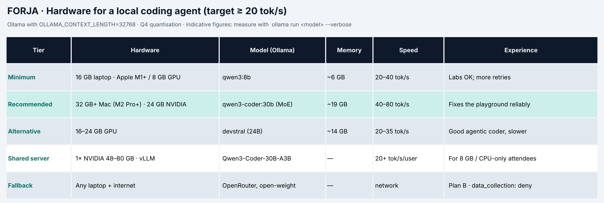

# Checklist de setup previo · Forja (hazlo ANTES del día)

🇬🇧 [English](setup_checklist.md) · Tiempo: 30–45 min, casi todo esperando descargas. Si algo falla, envía a [contacto] la salida de `forja doctor`.

## 1. Elige tu nivel de máquina



| Tu máquina | Modelo | Descarga | Velocidad orientativa |
|---|---|---|---|
| Portátil 16 GB (Apple M1+ o GPU 8 GB) | `qwen3:8b` | ≈ 5 GB | 20–40 tok/s |
| Mac 32 GB+ (M2 Pro/M3/M4) o GPU NVIDIA 24 GB | `qwen3-coder:30b` (MoE, 3B activos) | ≈ 19 GB | 40–80 tok/s |
| GPU 16–24 GB, alternativa | `devstral` (24B) | ≈ 14 GB | 20–35 tok/s |
| 8 GB o solo CPU | servidor compartido del aula u OpenRouter (open-weight) | — | depende de la red |

> Por debajo de ~15 tok/s un agente de código se hace pesado: cada tarea son 10–30 llamadas. Si es tu caso, avisa: usarás el servidor compartido.

## 2. Requisitos
- [ ] **Python ≥ 3.11** (`python --version`) y **Git**.
- [ ] ~25 GB libres si vas a por `qwen3-coder:30b`; ~8 GB para `qwen3:8b`.
- [ ] Permisos para instalar software (o pide a IT Ollama y Python preinstalados).
- [ ] Windows: funciona en `cmd` y PowerShell, sin `make` ni WSL.

## 3. Instalación
1. [ ] **Ollama** reciente: https://ollama.com/download (Linux: `curl -fsSL https://ollama.com/install.sh | sh`).
2. [ ] Contexto largo para Ollama (los agentes lo necesitan) y reinicia Ollama:
   - macOS/Linux: `export OLLAMA_CONTEXT_LENGTH=32768`
   - Windows: `setx OLLAMA_CONTEXT_LENGTH 32768` (y cierra/abre la app de Ollama)
3. [ ] Descarga tu modelo: `ollama pull qwen3:8b` (o `qwen3-coder:30b` / `devstral`).
4. [ ] Repo y entorno:
   ```bash
   git clone [repo] forja-workshop && cd forja-workshop
   python -m venv .venv
   source .venv/bin/activate          # Windows: .venv\Scripts\activate
   python scripts/tasks.py setup      # instala y crea .env
   ```
   PowerShell bloquea `activate`: `Set-ExecutionPolicy -Scope Process Bypass`.
5. [ ] Edita `.env`: `FORJA_MODEL=` con tu modelo.
6. [ ] Comprobación: `forja doctor` → backend accesible, el modelo llama tools y velocidad aproximada. Y `python scripts/tasks.py test 01` debe **fallar** con `NotImplementedError: TODO 01.x` (es lo esperado: lo programarás tú).

## 4. Opcional
- [ ] Clave de **OpenRouter** (`OPENROUTER_API_KEY`) como plan B; solo se permiten modelos open-weight.
- [ ] LM Studio o vLLM si ya los usas: `FORJA_BACKEND=openai_compat` y `FORJA_BASE_URL`.

## 5. El día
- [ ] **Desactiva los asistentes de IA del IDE** (Copilot, Cursor Tab, Codex, Claude…): vas a escribir tu propio agente y los tests te guían.
- [ ] Cargador: el modelo tendrá CPU/GPU ocupadas horas.
