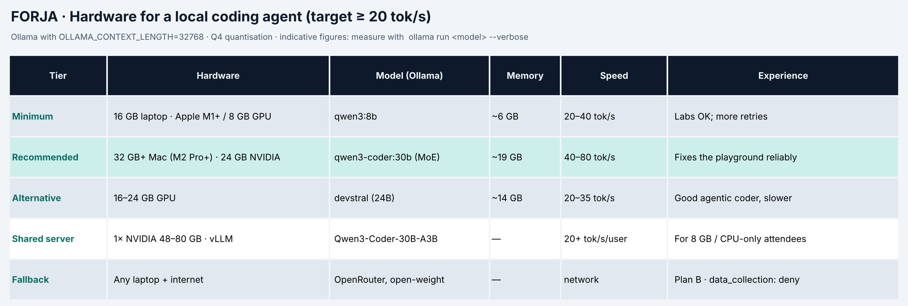

# Pre-workshop setup checklist · Forja (do this BEFORE the day)

🇪🇸 [Español](checklist_setup.md) · Time: 30–45 min, mostly waiting for downloads. If something fails, send [contact] the output of `forja doctor`.

## 1. Pick your machine tier



| Your machine | Model | Download | Rough speed |
|---|---|---|---|
| 16 GB laptop (Apple M1+ or 8 GB GPU) | `qwen3:8b` | ≈ 5 GB | 20–40 tok/s |
| 32 GB+ Mac (M2 Pro/M3/M4) or 24 GB NVIDIA GPU | `qwen3-coder:30b` (MoE, 3B active) | ≈ 19 GB | 40–80 tok/s |
| 16–24 GB GPU, alternative | `devstral` (24B) | ≈ 14 GB | 20–35 tok/s |
| 8 GB or CPU only | room shared server or OpenRouter (open-weight) | — | network-dependent |

> Below ~15 tok/s a coding agent feels slow: every task is 10–30 calls. If that's you, say so: you'll use the shared server.

## 2. Requirements
- [ ] **Python ≥ 3.11** (`python --version`) and **Git**.
- [ ] ~25 GB free for `qwen3-coder:30b`; ~8 GB for `qwen3:8b`.
- [ ] Rights to install software (or ask IT to preinstall Ollama and Python).
- [ ] Windows: works in `cmd` and PowerShell, no `make` or WSL needed.

## 3. Install
1. [ ] Recent **Ollama**: https://ollama.com/download (Linux: `curl -fsSL https://ollama.com/install.sh | sh`).
2. [ ] Long context for Ollama (agents need it), then restart Ollama:
   - macOS/Linux: `export OLLAMA_CONTEXT_LENGTH=32768`
   - Windows: `setx OLLAMA_CONTEXT_LENGTH 32768` (then quit/reopen the Ollama app)
3. [ ] Pull your model: `ollama pull qwen3:8b` (or `qwen3-coder:30b` / `devstral`).
4. [ ] Repo and environment:
   ```bash
   git clone [repo] forja-workshop && cd forja-workshop
   python -m venv .venv
   source .venv/bin/activate          # Windows: .venv\Scripts\activate
   python scripts/tasks.py setup      # installs and creates .env
   ```
   PowerShell blocks `activate`: `Set-ExecutionPolicy -Scope Process Bypass`.
5. [ ] Edit `.env`: set `FORJA_MODEL=` to your model.
6. [ ] Check: `forja doctor` → backend reachable, model calls tools, rough speed. And `python scripts/tasks.py test 01` must **fail** with `NotImplementedError: TODO 01.x` (expected: you'll write it).

## 4. Optional
- [ ] **OpenRouter** key (`OPENROUTER_API_KEY`) as plan B; only open-weight models are allowed.
- [ ] LM Studio or vLLM if you already use them: `FORJA_BACKEND=openai_compat` and `FORJA_BASE_URL`.

## 5. On the day
- [ ] **Turn off IDE AI assistants** (Copilot, Cursor Tab, Codex, Claude…): you're writing your own agent and the tests guide you.
- [ ] Charger: the model will keep CPU/GPU busy for hours.
